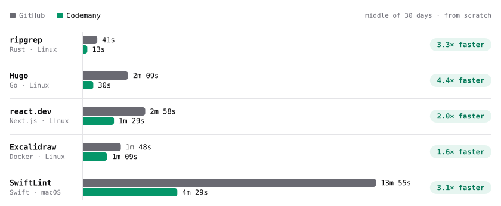
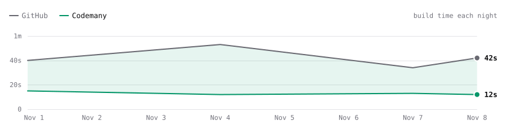
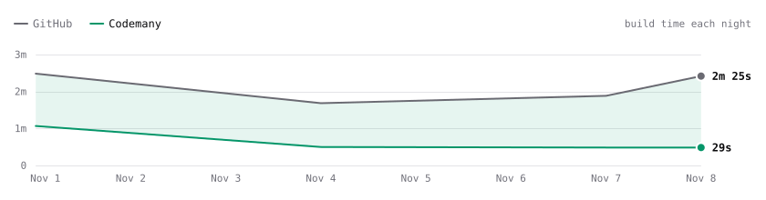
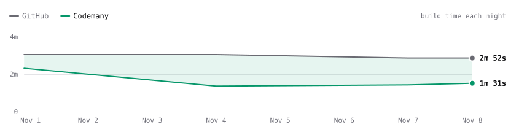
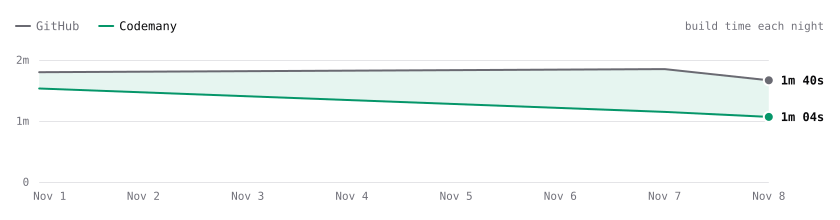
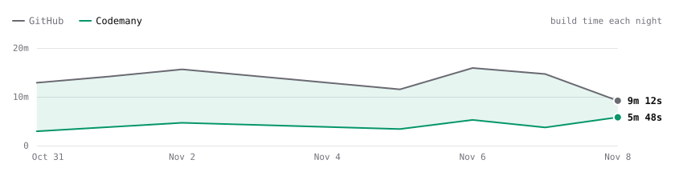
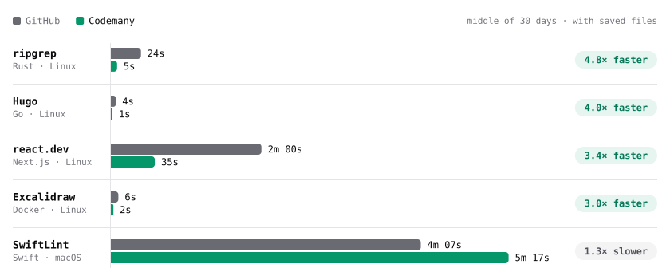

# Codemany Bench

Every night we build the same code twice: once on GitHub's computer, once on a small [Codemany](https://codemany.com) computer. **The shorter bar wins.**

<picture>
  <source media="(prefers-color-scheme: dark)" srcset="charts/speed-cold-dark.svg">
  
</picture>

**Green is Codemany. Black is GitHub.** The full page is at **[codemany.com/benchmarks](https://codemany.com/benchmarks)**.

## Who is faster?

<!-- bench:start -->
Time to build each project from scratch, for **private code** (the middle of the last 30 days). Updated 2026-11-08.

| Project | GitHub | Codemany | Codemany is… | Check it |
| --- | --- | --- | --- | --- |
| ripgrep | 41s | 13s | **3.3× faster** | GitHub (private run) · [Codemany](https://github.com/codemanyhq/bench/actions/runs/42471415877/job/128711807451) |
| Hugo | 2m 09s | 30s | **4.4× faster** | GitHub (private run) · [Codemany](https://github.com/codemanyhq/bench/actions/runs/42471415877/job/128711809317) |
| react.dev | 2m 58s | 1m 29s | **2.0× faster** | GitHub (private run) · [Codemany](https://github.com/codemanyhq/bench/actions/runs/42471415877/job/128711810485) |
| Excalidraw | 1m 48s | 1m 09s | **1.6× faster** | GitHub (private run) · [Codemany](https://github.com/codemanyhq/bench/actions/runs/42471415877/job/128711771197) |
| SwiftLint | 13m 55s | 4m 29s | **3.1× faster** | [GitHub](https://github.com/codemanyhq/bench/actions/runs/42432582391/job/128584531938) · [Codemany](https://github.com/codemanyhq/bench/actions/runs/42432582391/job/128584531964) |

Public code? GitHub runs it for free, on a bigger Linux computer. See **More numbers**.

### Every night, the last 30 days (private code, from scratch)

**ripgrep**

<picture>
  <source media="(prefers-color-scheme: dark)" srcset="charts/trend-ripgrep-dark.svg">
  
</picture>

**Hugo**

<picture>
  <source media="(prefers-color-scheme: dark)" srcset="charts/trend-hugo-dark.svg">
  
</picture>

**react.dev**

<picture>
  <source media="(prefers-color-scheme: dark)" srcset="charts/trend-react-dev-dark.svg">
  
</picture>

**Excalidraw**

<picture>
  <source media="(prefers-color-scheme: dark)" srcset="charts/trend-excalidraw-dark.svg">
  
</picture>

**SwiftLint**

<picture>
  <source media="(prefers-color-scheme: dark)" srcset="charts/trend-swiftlint-dark.svg">
  
</picture>

<b>More numbers</b>: public code, with saved files, prices

### Private code, from scratch

| Project | GitHub | Waited | Codemany | Waited | Result | GitHub price¹ |
| --- | --- | --- | --- | --- | --- | --- |
| ripgrep | 41s | 3s | 13s | 8s | 3.3× faster | $0.01 |
| Hugo | 2m 09s | 3s | 30s | 44s | 4.4× faster | $0.02 |
| react.dev | 2m 58s | 3s | 1m 29s | 1m 39s | 2.0× faster | $0.02 |
| Excalidraw | 1m 48s | 3s | 1m 09s | 52s | 1.6× faster | $0.01 |
| SwiftLint | 13m 55s | 2s | 4m 29s | 2s | 3.1× faster | $0.90 |

### Private code, with saved files

<picture>
  <source media="(prefers-color-scheme: dark)" srcset="charts/speed-warm-dark.svg">
  
</picture>

| Project | GitHub | Waited | Codemany | Waited | Result | GitHub price¹ |
| --- | --- | --- | --- | --- | --- | --- |
| ripgrep | 24s | 2s | 5s | 0s | 4.8× faster | <$0.01 |
| Hugo | 4s | 2s | 1s | 0s | 4.0× faster | <$0.01 |
| react.dev | 2m 00s | 2s | 35s | 0s | 3.4× faster | $0.02 |
| Excalidraw | 6s | 2s | 2s | 3m 48s | 3.0× faster | <$0.01 |
| SwiftLint | 4m 07s | 0s | 5m 17s | 0s | 1.3× slower | $0.30 |

### Public code (free on GitHub), from scratch

| Project | GitHub | Waited | Codemany | Waited | Result |
| --- | --- | --- | --- | --- | --- |
| ripgrep | 29s | 2s | 13s | 1s | 2.2× faster |
| Hugo | 1m 16s | 2s | 32s | 1m 20s | 2.4× faster |
| react.dev | 2m 00s | 2s | 1m 23s | 3m 20s | 1.4× faster |
| Excalidraw | 1m 17s | 2s | 1m 10s | 7m 15s | 1.1× faster |
| SwiftLint | 13m 55s | 2s | 4m 29s | 2s | 3.1× faster |

### Public code (free on GitHub), with saved files

| Project | GitHub | Waited | Codemany | Waited | Result |
| --- | --- | --- | --- | --- | --- |
| ripgrep | 12s | 0s | 5s | 0s | 2.4× faster |
| Hugo | 2s | 0s | 2s | 0s | about the same |
| react.dev | 1m 13s | 0s | 35s | 0s | 2.1× faster |
| Excalidraw | 56s | 2s | 56s | 9m 46s | about the same |
| SwiftLint | 4m 07s | 0s | 5m 17s | 0s | 1.3× slower |

¹ What one GitHub build costs for private code, at the prices in [The computers](#the-computers). Public code is free.

<!-- bench:end -->

## The computers

<!-- computers:start -->
You buy a Codemany computer once and keep it.

| Our computer | What's inside | Get one |
| --- | --- | --- |
| Mini PC (Linux) | 8 cores, 32 GB memory, 1 TB disk | [Get one](https://www.amazon.com/dp/B0DRVSK2T9) (MINISFORUM UM870, 32 GB, 1 TB) |
| Mac mini (macOS) | 12 cores, 16 GB memory, 256 GB disk | [Get one](https://www.amazon.com/dp/B0HGGJZ92H) (M6, 16 GB, 256 GB) |

You rent a GitHub computer by the minute. What you get depends on your code.

**For private code**

| GitHub's computer | What's inside | Price per minute |
| --- | --- | --- |
| `ubuntu-latest` (Linux) | 2 cores, 7 GB memory, 14 GB disk | [$0.006](https://docs.github.com/en/billing/reference/actions-runner-pricing) |
| `macos-latest` (macOS) | 3 cores (Apple M1), 7 GB memory, 14 GB disk | [$0.062](https://docs.github.com/en/billing/reference/actions-runner-pricing) |

**For public code (free)**

| GitHub's computer | What's inside | Price per minute |
| --- | --- | --- |
| `ubuntu-latest` (Linux) | 4 cores, 16 GB memory, 14 GB disk | Free |
| `macos-latest` (macOS) | 3 cores (Apple M1), 7 GB memory, 14 GB disk | Free |

Checked 2026-11-01 on GitHub's [price list](https://docs.github.com/en/billing/reference/actions-runner-pricing) and [computer list](https://docs.github.com/en/actions/reference/runners/github-hosted-runners).
<!-- computers:end -->

## Fair and true

We show the real time and the real price. We don't make GitHub or Codemany look better than they are.

- **Private code first.** That's the code teams pay for, so the tables show it first.
- **Private times come every night too.** GitHub gives private code a smaller Linux computer (2 cores). The only way to get that computer is to build from a private project. So a private copy of this test runs every night, and we copy its times here. Trial projects run there on Sundays and Wednesdays only.
- **Public code is free on GitHub.** It gets a bigger Linux computer (4 cores). Those times are under **More numbers**. Macs are the same for both.
- **Same code, same steps.** Both sides build the exact same version, with the project's own build command and the same tools.
- **You can check.** Each time links to its real run on GitHub. Only the private runs can't be opened, because that project is private.
- **Some things stay on a Codemany computer.** On Codemany, Docker images and tools stay on the computer between runs, like on any computer you own. GitHub gives every job a fresh computer with its own tools already on it. Saved build files never carry over to a "from scratch" build, on either side. [What stays](#what-stays-on-a-codemany-computer) lists all of it.
- **We show the wait.** Next to each build time is how long the job waited for a computer. Codemany's computer takes one bench build at a time, so later builds wait for the ones before them.
- **Codemany costs $20 a month** for 2 computers. Codemany runs on a computer you own. That computer isn't in this price.

<b>How we test, in detail</b>

### What we build

<!-- projects:start -->
| Project | Language | Computer | Build command | Exact commit |
| --- | --- | --- | --- | --- |
| [ripgrep](https://github.com/BurntSushi/ripgrep) | Rust | Linux | `cargo build --release` | [`91f5d22`](https://github.com/BurntSushi/ripgrep/commit/91f5d22ef48bde459d90a8c7dbeab416e97d0f2b) |
| [Hugo](https://github.com/gohugoio/hugo) | Go | Linux | `go install` | [`8502b60`](https://github.com/gohugoio/hugo/commit/8502b60066b1059c0e24275ef8a3b642b1b2a10b) |
| [react.dev](https://github.com/reactjs/react.dev) | Next.js | Linux | `yarn install --frozen-lockfile && next build` | [`0821e7d`](https://github.com/reactjs/react.dev/commit/0821e7d9428a6c58c922765b891bbffba9ed6249) |
| [Excalidraw](https://github.com/excalidraw/excalidraw) | Docker | Linux | `docker build -t excalidraw .` | [`a758e93`](https://github.com/excalidraw/excalidraw/commit/a758e93d6a03e9f995973703cb886850a398a6d3) |
| [SwiftLint](https://github.com/realm/SwiftLint) | Swift | macOS | `swift build -c release --product swiftlint` | [`ec4691d`](https://github.com/realm/SwiftLint/commit/ec4691d9e813a1d3358e82917326b56b0a71d3c9) |
| [TypeScript 7 compiler](https://github.com/microsoft/TypeScript) *(new: results appear after 3 clean nights)* | Node.js | Linux | `npm ci && npx hereby build` | [`6161772`](https://github.com/microsoft/TypeScript/commit/6161772c1370bdd4a82f808e6823bd755eb1870d) |
| [Ruff](https://github.com/astral-sh/ruff) *(new: results appear after 3 clean nights)* | Rust | Linux | `cargo build --release --locked --bin ruff` | [`049c351`](https://github.com/astral-sh/ruff/commit/049c351befba87447d3d50a2ee3d617ce3c2a264) |
| [Django tests](https://github.com/django/django) *(new: results appear after 3 clean nights)* | Python | Linux | `pip install -r tests/requirements/py3-free-threading.txt -e . && python -Wall tests/runtests.py` | [`a05e16a`](https://github.com/django/django/commit/a05e16a7230fe33d3f43f4a3aaed103cebb42efc) |
| [Kubernetes (kubectl)](https://github.com/kubernetes/kubernetes) *(new: results appear after 3 clean nights)* | Go | Linux | `make WHAT=cmd/kubectl` | [`aa8de06`](https://github.com/kubernetes/kubernetes/commit/aa8de068063335aee4a78589ee0d5c70b448e266) |
| [Firefox for iOS](https://github.com/mozilla-mobile/firefox-ios) *(new: results appear after 3 clean nights)* | iOS | macOS | `./bootstrap.sh firefox && xcodebuild build-for-testing -scheme Fennec (iOS Simulator)` | [`167e2d2`](https://github.com/mozilla-mobile/firefox-ios/commit/167e2d22f55c47bcaad32dd5d95804b7f7a924a6) |
| [Composable Architecture tests](https://github.com/pointfreeco/swift-composable-architecture) *(new: results appear after 3 clean nights)* | Swift | macOS | `xcodebuild test -scheme ComposableArchitecture -destination platform=macOS` | [`bb175b5`](https://github.com/pointfreeco/swift-composable-architecture/commit/bb175b544d019c7f23a2e41ae29d8c70592aeb58) |
| [Now in Android](https://github.com/android/nowinandroid) *(new: results appear after 3 clean nights)* | Android | Linux | `./gradlew :app:assemble -PminifyWithR8=false` | [`2982e63`](https://github.com/android/nowinandroid/commit/2982e63cb691ad49cd009aab43dc206fee6699c2) |
| [Neovim](https://github.com/neovim/neovim) *(new: results appear after 3 clean nights)* | C | Linux | `cmake --preset ci -D CMAKE_BUILD_TYPE=Release && cmake --build build` | [`2fc7032`](https://github.com/neovim/neovim/commit/2fc7032df9e7b7e4d625cc205a5ff9cdb0f02b27) |
<!-- projects:end -->

### From scratch, and with saved files

Builds keep files around to go faster next time (a *cache*).

| How | What it means |
| --- | --- |
| From scratch | Every saved file is thrown away first, on both computers. Nothing is asked of any cache: no restore, no fallback key, and the tools' own caches (`setup-node`, `setup-go` and the rest) are off. [`scripts/check-cold.mjs`](scripts/check-cold.mjs) stops the run if that ever changes. |
| With saved files | The from-scratch build saves its files, and the build with saved files downloads them first, on both computers (private Linux: last week's files). GitHub serves them from its cache. On the Codemany Linux computer, Codemany's own cache serves them, from that computer's disk. Each save has the run's number in its name, so a build only ever gets files from its own run. For Docker, a step after the timed build writes its layers to those files (not timed, on both computers); the build with saved files reads them and writes nothing back. |

### What stays on a Codemany computer

A Codemany computer is a computer you own, so some things stay on it between jobs. Here is all of it, and what we do about it.

| What stays | Does it help a build from scratch? |
| --- | --- |
| The job's home folder | No. Codemany empties it after every job. |
| Saved build files (Codemany's own cache for `actions/cache`) | No. Builds from scratch never ask for them, and every name has the run's number in it. GitHub's cache is emptied at the start of each run; Codemany's can't be from here, and doesn't need to be. |
| Saved downloads for private code (Codemany keeps Go, npm, pip, Cargo, Gradle files per owner) | No. This repo is public, so it gets none. Every one of those folders is pointed at the build's own folder anyway, which starts empty from scratch. |
| Docker Hub images in Codemany's local copy (a mirror) | No. Builds from scratch start BuildKit without the mirror, so they download from Docker Hub, like GitHub. Builds with saved files use the mirror. |
| Docker images in the computer's Docker | Only before the clock starts: BuildKit's own image. The build itself starts BuildKit fresh. |
| Tools (Go, Node, Python, Java, Xcode, Rust) | Only before the clock starts. GitHub's computers come with tools on them too. |
| The Android SDK | No. Both sides start every Android job with an empty SDK folder and download what the build needs. |

### What we time

- Only the `build` step. Getting tools and saved files ready happens before the clock starts, on both sides.
- Codemany builds one project at a time, so each build gets the whole computer, like a fresh GitHub computer does.
- The wait is timed too, on its own: from when GitHub makes the job to when a computer starts it (`queueSec` in [`data/results.json`](data/results.json)). It is never in the build time. On Codemany, a build waits for the ones before it, because the computer takes one at a time.
- Public builds start every night at 03:17 UTC. Private Linux builds start every night at 05:17 UTC.

### Check it yourself

1. Open the [bench runs](https://github.com/codemanyhq/bench/actions/workflows/bench.yml).
2. Pick a job, like `ripgrep · codemany · cold`.
3. Open its `build` step. That time is the number in our table.

Private Linux times come from `codemanyhq/bench-private`. It runs the same `github` job as [`bench.yml`](.github/workflows/bench.yml), with this repo's scripts, on GitHub's computer for private code. Only we can open its runs.

The raw numbers are in [`data/results.json`](data/results.json); [`scripts/collect.mjs`](scripts/collect.mjs) reads them from GitHub. To run it yourself, fork this repo and connect a self-hosted runner with the labels `self-hosted`, `Linux` (or `macOS`) and `codemany`.

### Safety

This repo never runs code from strangers: it runs only on a timer or the **Run workflow** button, never on pull requests. Builds get a read-only token. The collector reads the private copy with a read-only token, and only commits `data/`, `charts/` and this README. Every outside action and project is pinned to an exact commit.

## License

[MIT](LICENSE)
